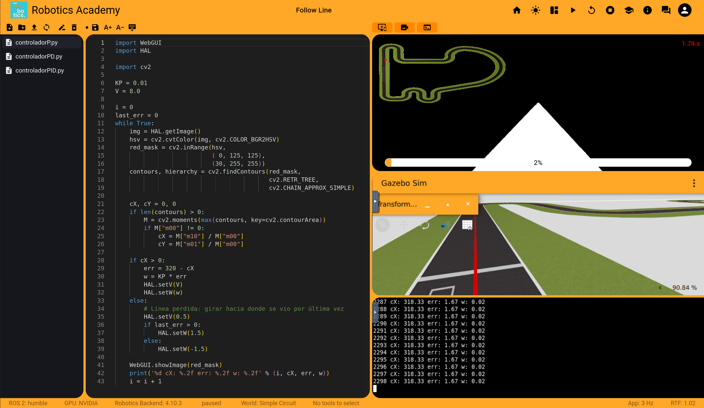
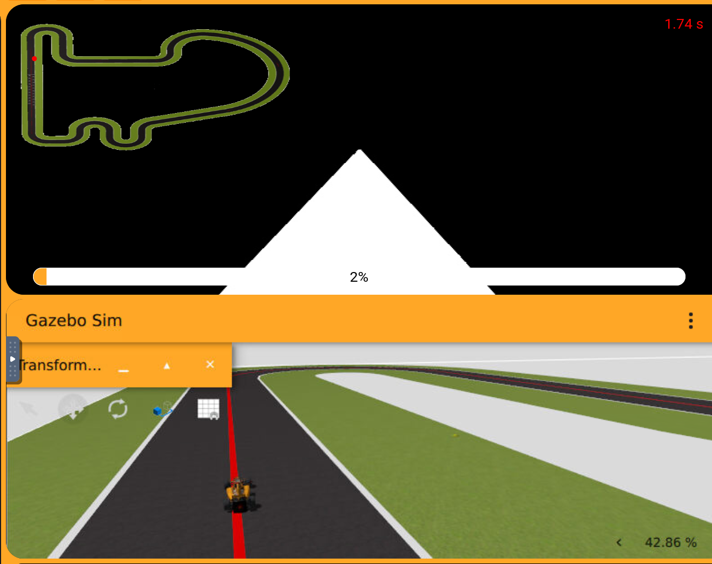
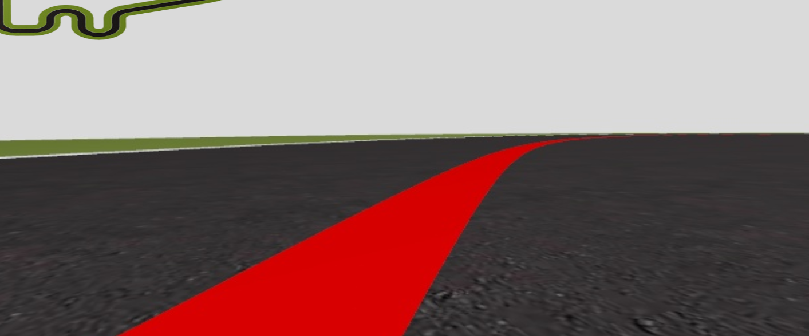
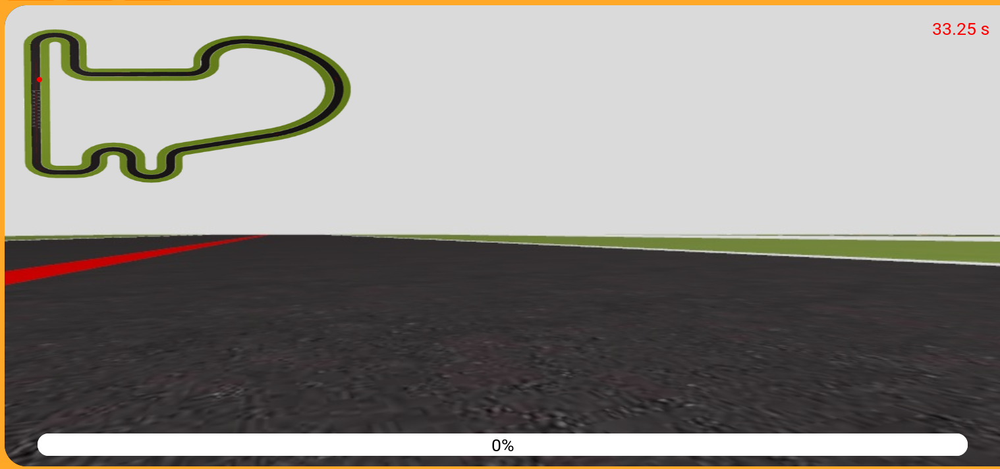
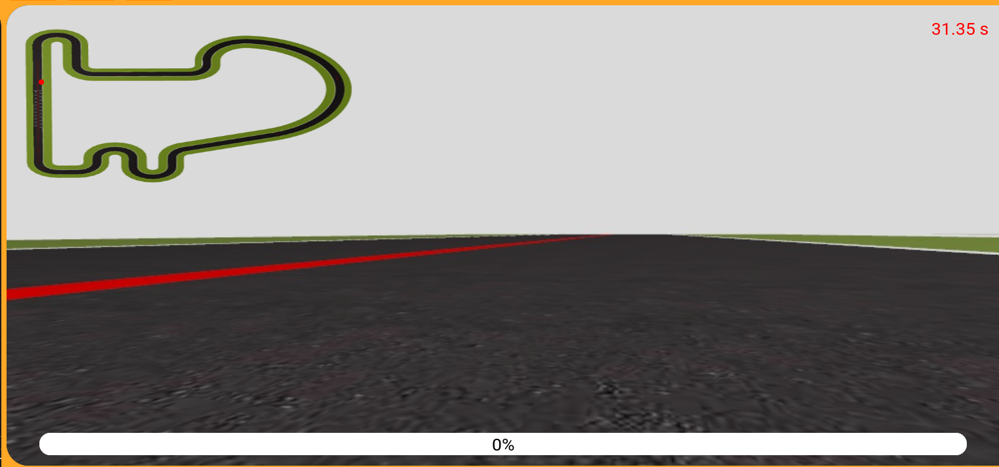

# Follow Line – Unibotics (Robotics Academy)

Solution to the **Follow Line** exercise from [Unibotics](https://unibotics.org/apps/academy/studio/follow_line). A simulated Formula 1 car in Gazebo has to complete a lap of the circuit by following the red line painted on the track, using **only its front camera**.

The problem is solved with **three control approaches**, each one building on the previous:

| Controller | File | Main idea | Lap time |
|---|---|---|---|
| **P** (Proportional) | [`controladorP.py`](controladorP.py) | Steering proportional to the error, constant speed | 67.23 s |
| **PD** (Proportional-Derivative) | [`controladorPD.py`](controladorPD.py) | Adds a derivative term to damp oscillations, plus adaptive speed | 33.25 s |
| **PID** (Proportional-Integral-Derivative) | [`controladorPID.py`](controladorPID.py) | Adds an integral term to remove the steady error in long curves | **31.35 s** |

> Lap times measured on an NVIDIA RTX 5060 setup. Speeds and gains may need
> re-tuning on other hardware (see [Performance](#performance)).

**Main result:** [full lap with the PID controller – 31.35 s](media/PID.webm)

---

## Table of contents

1. [What is the Follow Line exercise?](#what-is-the-follow-line-exercise)
2. [How to run it](#how-to-run-it)
3. [Perception: detecting the line](#perception-detecting-the-line)
4. [P controller](#p-controller)
5. [PD controller](#pd-controller)
6. [PID controller](#pid-controller)
7. [Performance](#performance)
8. [Problems found and solutions](#problems-found-and-solutions)

---

## What is the Follow Line exercise?

A *line follower* is one of the classic problems in mobile robotics. On every iteration the robot:

1. **Perceives**: gets an image from the camera and finds the line.
2. **Computes the error**: measures how far the line is from the centre of the image.
3. **Acts**: chooses a linear speed (`v`) and an angular speed (`w`) to get back on track.

This *perception → control → actuation* loop runs continuously inside a `while True` loop.

**API used (HAL and WebGUI):**

| Function | Description |
|---|---|
| `HAL.getImage()` | Returns the BGR image from the front camera (640×480) |
| `HAL.setV(v)` | Sets the linear speed (m/s) |
| `HAL.setW(w)` | Sets the angular speed (rad/s). Positive = turn left |
| `WebGUI.showImage(img)` | Shows an image in the web interface (useful for debugging) |

<p align="center">
  
  <br><em>General view of Unibotics with the exercise loaded: code editor on the left, circuit map, camera view and Gazebo on the right.</em>
</p>

<p align="center">
  
  <br><em>The Simple Circuit seen from above (the map in the top-left corner) next to the car's front camera view showing the red line.</em>
</p>

---

## How to run it

The simulation runs **locally** with the JdeRobot *Robotics Backend* (a Docker container). The code is written and launched from the **Unibotics website**, which connects to that backend.

**Requirements:** [Docker](https://docs.docker.com/get-docker/) and an account on [unibotics.org](https://unibotics.org).

### 1. Pull the image

```bash
docker pull jderobot/robotics-backend:latest
```

### 2. Launch the container

Choose **one** of these options depending on your graphics card:

**Option A: no graphics acceleration** (recommended if you don't need it or aren't sure)

```bash
docker run --rm -it -p 6080-6090:6080-6090 -p 7163:7163 jderobot/robotics-backend:latest
```

**Option B: generic acceleration** (Intel or AMD drivers)

```bash
docker run --rm -it --device /dev/dri -p 6080-6090:6080-6090 -p 7163:7163 jderobot/robotics-backend:latest
```

**Option C: NVIDIA GPU** (requires the NVIDIA driver and the NVIDIA Container Toolkit)

```bash
docker run --rm -it --device /dev/dri --gpus all -p 6080-6090:6080-6090 -p 7163:7163 jderobot/robotics-backend:latest
```

You can check that Docker sees the GPU with `docker run --rm --gpus all ubuntu nvidia-smi`.

Keep this terminal open while you use the simulator. Closing it (`Ctrl+C`) removes the container (`--rm`).


### 3. Run the exercise from the website

1. With the container running, log in to [unibotics.org](https://unibotics.org) and open **Robotics Academy → Follow Line**.
2. Wait until the website connects to the local backend.
3. Paste the contents of one of the controller files (P, PD or PID) into the editor.
4. Press **Play**. The car starts moving, and the bar under the map shows the percentage of the circuit completed.
5. To switch controllers, press **Reset**, paste the other code and run it again.

> **Note on the performance:** all lap times were measured on a local
> Robotics Backend (Docker) running on Ubuntu with an **NVIDIA GeForce RTX 5060**
> GPU. The simulation's Real Time Factor (RTF) and the controller's loop rate
> depend on the hardware: on a slower machine, or without GPU acceleration,
> camera images arrive later relative to the simulation and the car reacts
> later. **The parameters in this repository, especially the speeds
> (`V_MAX`, `V_MIN`), were tuned for this setup and may not work on other
> hardware.** If the car oscillates or leaves the track, start by lowering
> `V_MAX` and `V_MIN` and then re-tune `KP` and `KD`.

---

## Perception: detecting the line

All three controllers share the same perception stage:

```python
img = HAL.getImage()
hsv = cv2.cvtColor(img, cv2.COLOR_BGR2HSV)
red_mask = cv2.inRange(hsv, (0, 125, 125), (30, 255, 255))
contours, hierarchy = cv2.findContours(red_mask, cv2.RETR_TREE, cv2.CHAIN_APPROX_SIMPLE)

c = max(contours, key=cv2.contourArea)   # keep the largest contour
M = cv2.moments(c)
cX = M["m10"] / M["m00"]                 # x coordinate of the line's centroid
```

1. **Convert to HSV.** HSV separates colour (H) from brightness (V), so the colour filter is more robust to shadows and highlights than in BGR.
2. **Thresholding.** `inRange` builds a binary mask with the red pixels (H between 0 and 30, high saturation and value).
3. **Contours and moments.** The largest contour is kept, which discards noise, and its centroid `cX` is computed from the image moments.
4. **Error.** The difference between the centre of the image (`IMG_CENTER = 320`) and the line's centroid:

```
err = IMG_CENTER - cX
```

- `err > 0` → the line is to the left → turn left (`w > 0`).
- `err < 0` → the line is to the right → turn right (`w < 0`).

Using the centroid of the **whole** visible line, not just a row near the car, has a useful side effect: the far part of the line already bends when a curve is coming, so the error grows *before* the car reaches the curve. The controller anticipates curves for free.
<p align="center">
  
  <br><em>The line the car sees.</em>
</p>

---

## [P controller](controladorP.py)

### How it works

The simplest form of control: the angular speed is **proportional to the error**, and the linear speed is constant.

$$w = K_P \cdot e$$

```python
KP = 0.01   # proportional gain
V  = 2.0    # constant linear speed (m/s)

err = 320 - cX
w = KP * err
HAL.setV(V)
HAL.setW(w)
```

If the car loses the line, instead of stopping, it turns towards the side where it last saw it (given by the sign of prev_err) until it finds it again.

### Results and limitations

- At low speed (2 m/s) it **completes the lap**, but slowly: **67.23 s**.
- When the speed goes up, the car **oscillates** around the line (zigzag) and ends up leaving the track in the curves. A P controller only reacts to *where* the line is, not to *how fast* the car is approaching it, so it always arrives with inertia and overshoots.
- It's a trade-off: with a low `KP` the car goes wide in the curves; with a high `KP` it oscillates on the straights.

**Video:** [full lap with the P controller – 67.23 s](media/P.webm)

[P.webm](https://github.com/user-attachments/assets/1ba3f82c-9528-485b-84fa-2c20e90cf9f0)

---

## [PD controller](controladorPD.py)

### How it works

A **derivative term** is added. It measures how much the error has changed since the previous iteration and acts as a *damper*: if the car is approaching the line quickly, the derivative has the opposite sign and reduces the steering before the car overshoots.

$$w = K_P \cdot e + K_D \cdot \frac{de}{dt} \approx K_P \cdot e_k + K_D \cdot (e_k - e_{k-1})$$

**Adaptive speed** is also introduced. The car goes at `V_MAX` when the line is centred (straight) and slows down linearly to `V_MIN` as the error grows (curve):

$$v = V_{MAX} - \frac{|e|}{IMG\_CENTER} \cdot (V_{MAX} - V_{MIN})$$

```python
KP = 0.010
KD = 0.011
V_MAX = 28.0
V_MIN = 8.0

derivative = err - prev_err
w_dyn = KP * err + KD * derivative
v_dyn = V_MAX - (abs(err) / IMG_CENTER) * (V_MAX - V_MIN)

HAL.setV(v_dyn)
HAL.setW(w_dyn)
prev_err = err
```

### Recovering the line

If the car loses the line, instead of stopping, it **turns towards the side where it last saw it** (given by the sign of `prev_err`) until it finds it again:

```python
else:
    HAL.setV(0.5)
    if prev_err > 0:
        HAL.setW(1.5)    # the line was on the left
    else:
        HAL.setW(-1.5)   # the line was on the right
```

### Results and limitations

- Much **more stable on the straights** and much **faster** than the P controller, thanks to the adaptive speed.
- **Lap time: 33.25 s**, about half the time of the P controller.
- During tuning, the car left the track in the **second-to-last curve** (the tight chicane near the end, around 80 % of the lap) whenever it reached it too fast. The line disappeared from the camera, and with the first version of the code the car simply stopped.
- In long curves the car drives slightly towards the outside, because a PD controller needs some error to be able to turn.

<p align="center">
  
  <br><em>Lap completed with the PD controller: 33.25 s (simulated time).</em>
</p>

**Video:** [full lap with the PD controller – 33.25 s](media/PD.webm)

[PD.webm](https://github.com/user-attachments/assets/d964409e-dd09-4fd9-bf86-b1e52256d34e)

---

## [PID controller](controladorPID.py)

### How it works

An **integral term** is added. It accumulates the error over time: if the car keeps driving slightly to one side, as in a long curve, the integral grows and adds extra steering until the error is corrected.


$$w = K_P \cdot e_k + K_I \cdot \sum_{j=0}^{k} e_j + K_D \cdot (e_k - e_{k-1})$$

```python
KP = 0.010
KD = 0.011
KI = 0.000001
V_MAX = 30.0
V_MIN = 8.0

derivative = err - last_err
integral  += err
w_dyn = KP * err + KD * derivative + KI * integral
v_dyn = V_MAX - (abs(err) / IMG_CENTER) * (V_MAX - V_MIN)
```

`KI` is deliberately very small. The integral adds up the error from every iteration (hundreds of pixels, many times per second), so a larger value would make it grow too much and the car would overshoot when leaving the curves.

The line-recovery behaviour is the same as in the PD controller.

### Results

- **Lap time: 31.35 s**, the fastest of the three.
- With the same `KP`, `KD` and `V_MIN` as the PD, it allows a higher top speed (`V_MAX = 30` vs 28). The integral term keeps the car better centred in the long curves, so it reaches the tight sections in a better position.
- Note: the integral term has no limit (*anti-windup*) and isn't reset when the line is lost. With this small `KI` it causes no problems, but a larger `KI` would need both.

<p align="center">
  
  <br><em>Lap completed with the PID controller: 31.35 s (simulated time).</em>
</p>

**Video:** [full lap with the PID controller – 31.35 s](media/PID.webm)

[PID.webm](https://github.com/user-attachments/assets/6ceb65c9-03ce-449a-ae41-741449f6211d)

---

## Performance

| | P | PD | PID |
|---|---|---|---|
| `KP` | 0.01 | 0.010 | 0.010 |
| `KD` | – | 0.011 | 0.011 |
| `KI` | – | – | 0.000001 |
| Speed (m/s) | 2.0 (constant) | 8.0 – 28.0 | 8.0 – 30.0 |
| Line recovery | No (stops) | Yes (turns to last side) | Yes (turns to last side) |
| Oscillations on straights | High | Low | Low |
| **Lap time (simulated)** | 67.23 s | 33.25 s | **31.35 s** |
| Improvement over previous | – | −50.5 % | −5.7 % |

> **Note on the test environment:** all lap times were measured on a local
> Robotics Backend (Docker) running on Ubuntu with an **NVIDIA GeForce RTX 5060**
> GPU. The simulation's Real Time Factor (RTF) and the controller's loop rate
> depend on the hardware: on a slower machine, or without GPU acceleration,
> camera images arrive later relative to the simulation and the car reacts
> later. **The parameters in this repository, especially the speeds
> (`V_MAX`, `V_MIN`), were tuned for this setup and may not work on other
> hardware.** If the car oscillates or leaves the track, start by lowering
> `V_MAX` and `V_MIN` and then re-tune `KP` and `KD`.

### Conclusions

- The **P** controller is enough at low speed but doesn't scale: as soon as it speeds up, it oscillates.
- The **PD** controller is the biggest improvement: **67.23 s → 33.25 s**, half the lap time. The derivative term removes the oscillations, and adaptive speed lets the car go fast on the straights and slow down in the curves.
- The **PID** controller is the fastest (**31.35 s**, about 6 % faster than the PD). The gain is smaller, because the integral term only adds a small correction in long curves, but it lets the car keep a higher top speed.
- What decides whether the car finishes the lap is **slowing down enough in the tight curves** (`V_MIN`). A car that never loses the line is faster than one that is very fast on the straights but has to recover several times per lap.

---

## Problems found and solutions

| Problem | Cause | Solution |
|---|---|---|
| The car stops in the middle of the circuit | When the line was lost, the code called `setV(0)` and `setW(0)`. Without moving, the car never saw the line again | Turn towards the side where the line was last seen (sign of the last error) |
| It leaves the track in the second-to-last curve | It reaches the chicane too fast | Tune `V_MIN` / `V_MAX` and the gains |
| Recovery fails after hitting the track edge | While moving forward into the edge, the car can't turn | Turn more sharply (`w = ±1.5`) at very low speed |
| Raising `V_MIN` too much made the lap *slower* | The car lost the line in the curves and spent seconds recovering at 0.5 m/s | Keep `V_MIN` low enough to never lose the line |
| Very long real waiting times | Low RTF: Gazebo rendering on the CPU instead of the GPU | Use the GPU options of the container, close the Gazebo 3D panel and other heavy programs |
| Different behaviour between runs | Varying RTF: images arrive with more or less delay relative to the simulation | Compare results with a similar RTF |
| The car can't be stopped after one lap | `HAL` has no `getPose3d()` in this exercise, so the car's position isn't available | The car keeps running in a continuous loop |

---


**Miriam** – Universitat Jaume I (UJI)
